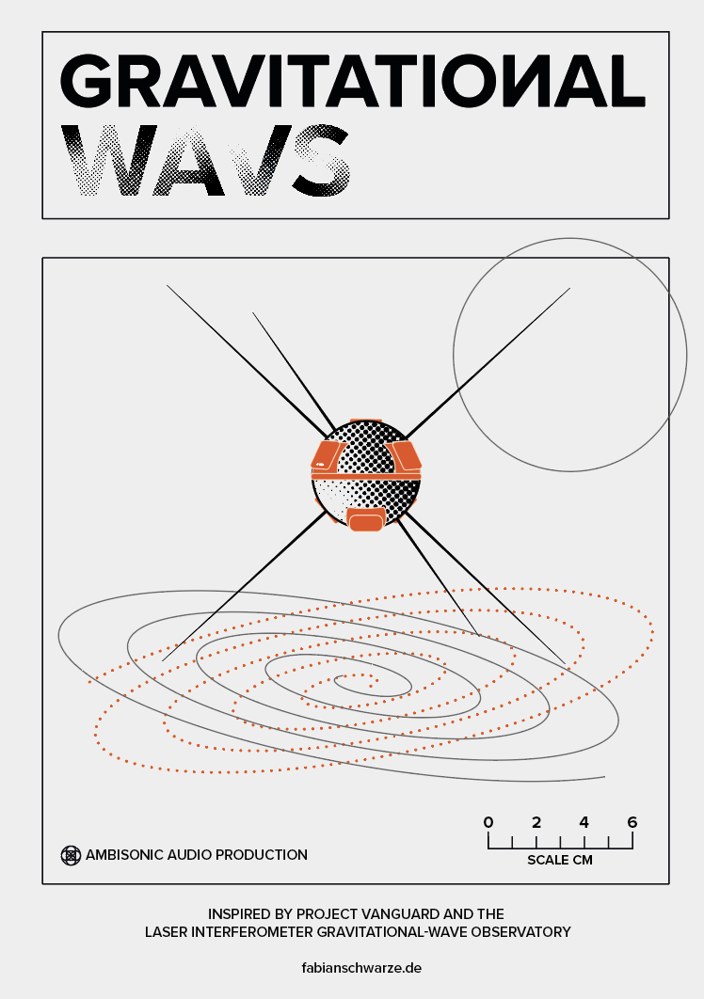

# gravitationalWAVS - Projekthandbuch

## Arbeitspakete

### Sample-Recherche

#### ESA/NASA Daten

### wissenschaftliche Grundlagen

#### Gravitationswellen und mathematische Berechnungen

### Hardwareprototyp

#### Hardwareauswahl

### Softwartests

#### Softwareauswahl

##### Ableton Live

Mit Max for Live und SPAT Bundle von Music Unit oder XP for Live

##### Max9

direkt mit ircam spat

#### Eignungsprüfung

## Zeitplanung

| Zeitraum | Arbeitspaket | Arbeitszeit |
| --- | --- | --- |
| Bis Ende November | Hardwareprototyp fertigstellen | Noch festzulegen |
| Bis Ende November | Softwartests abschließen | 20 h |
| Bis Ende November | Sample Recherche | Noch festzulegen |

| Zuletzt | Feinabstimmung | 20 h |

## Ressourcenplanung

### Materialien

| Benötigte Ressourcen | Begründung | Kosten |
| --- | --- | --- |
| Seeed Studio XIAO ESP32C6 | Controllerbau | ca. 20 € |
| Adafruit 9-DOF Orientation IMU Fusion Breakout, BNO085 | Controllerbau | ca. 40 € |
| ELEGOO Matte PLA Filament 1.75mm Schiefergrau | Controllerbau | ca. 20 € |
| LiPo-Akku 3,7 V, 1200 mAh | Controllerbau | ca. 15 € |
| MAX9 | Softwarebackend | 199 € |
| Gesamt | | ca. 294 € |

### Räume

| Raum | Zweck | Verfügbarkeit |
| --- | --- | --- |
| 3D-Audio-Labor | 3D-Audio-Experimente | nach Vereinbarung |
| Makerlab | Lötarbeiten, 3D-Druck | jederzeit |

### Literatur und Recherche

| Quelle | Thema | Verfügbarkeit |
| --- | --- | --- |
| Besuch im technischen Museum Wien | Wissenschaftliche Grundlagen | Nach Vereinbarung |

## Konzept

## Chancen und Risiken

## erwarteter Kompetenzgewinn

## Software

## Hardware