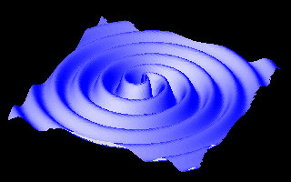
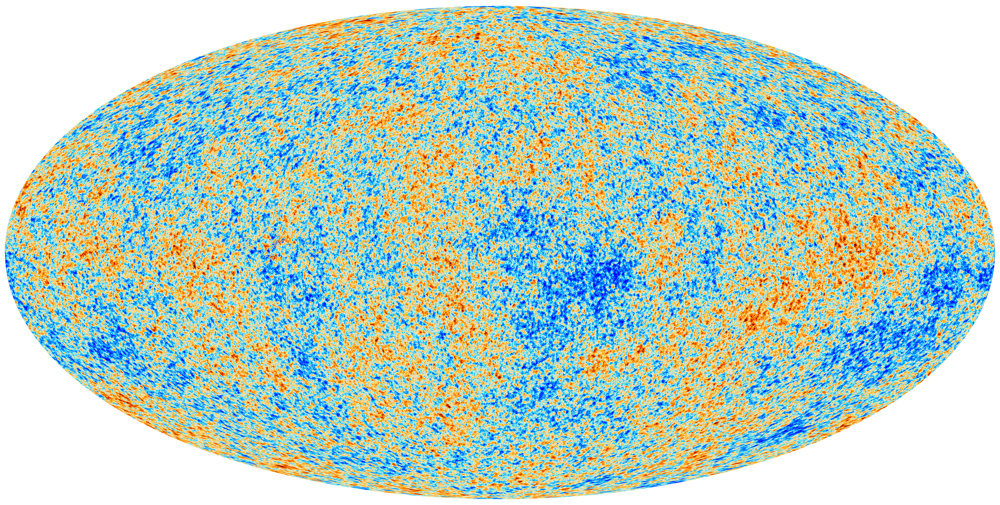
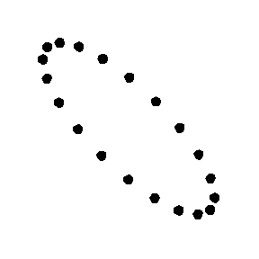
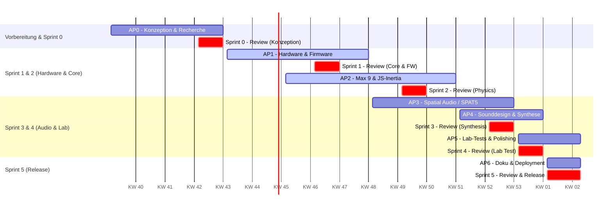

# gravitationalWAVS - Projekthandbuch

## TLDR

**gravitationalWAVS** ist eine interaktive 3D-Audio-Installation zur psychoakustischen Vermittlung von Gravitationswellen und Raumzeit-Dehnungen in Museums- und Wissenschaftskontexten. Über einen kabellosen, sputnik-inspirierten Haptik-Controller (ESP32/IMU via OSC) steuern Rezipient*innen die Orbits zweier gekoppelter Schwarzer Löcher in einem 3D-Klangfeld. Das System wird vollständig als autarke Standalone-Applikation in Max 9 mit IRCAM SPAT5 (Higher Order Ambisonics) umgesetzt, wobei mathematische Trägheitsfilter (Inertia) eine spürbare Illusion von physischer Masse im Raum erzeugen.

## Inhaltsverzeichnis

- [TLDR](#tldr)
- [Konzept](#konzept)
- [Wissenschaftliche & Technische Beratung](#wissenschaftliche--technische-beratung)
- [Arbeitspakete](#arbeitspakete)
- [Zeitplanung](#zeitplanung)
- [Ressourcenplanung](#ressourcenplanung)
  - [Materialien & Software-Lizenzen](#materialien--software-lizenzen)
  - [Räume](#räume)
  - [Literatur und Recherche](#literatur-und-recherche)
- [Chancen und Risiken](#chancen-und-risiken)
- [Erwarteter Kompetenzgewinn](#erwarteter-kompetenzgewinn)
- [Software](#software)
- [Hardware](#hardware)
- [Werbung](#werbung)

---

## Konzept

Das Ziel des Projekts **GRAVITATIONAL WAVs** ist es, ein fundamentales Phänomen des Universums – die 2015 erstmals gemessenen Gravitationswellen – interaktiv, haptisch und psychoakustisch greifbar zu machen. Wenn massereiche Objekte wie Schwarze Löcher oder Neutronensterne kollidieren, stauchen und dehnen sie die Raumzeit.

<figure>
  
   
  <figcaption"><i>Zweidimensionale Betrachtung von Gravitationswellen, die von zwei einander umkreisenden Neutronensternen ausgesandt werden</i></figcaption>
</figure>

In der Installation wird dieses Prinzip in ein dreidimensionales Klangfeld übersetzt:

1/ **Cosmic Microwave Background (CMB):** Ein fundamentales, waberndes Hintergrundrauschen repräsentiert die kosmische Mikrowellen-Hintergrundstrahlung. [Audiobeispiel online](https://www.youtube.com/watch?v=gJJmFnMea1Q)

<figure>
  
   
  <figcaption"><i>Kosmische Mikrowellen-Hintergrundstrahlung</i></figcaption>
</figure>

2/ **Binary Black Hole System:** Zwei gekoppelte Soundobjekte simulieren zwei einander umkreisende Schwarze Löcher.

3/ **Testpartikel-Ring:** Ein virtueller Ring aus Soundquellen macht die Polarisation ($h_+$ und $h_\times$) der Raumzeit-Dehnung auditiv erfahrbar.

<figure>
  
   
  <figcaption">*Der Effekt von kreuzpolarisierten Gravitationswellen auf einen Partikelring.*</figcaption>
</figure>
 

4/ **Interaktiver Controller & Trägheits-Engine:** Über ein physisches Objekt mit Gyroskop greifen die Zuhörer direkt in das System ein. Über mathematische Trägheitsfilter (Inertia) besitzen die Schwarzen Löcher eine spürbare Masse: Bei einer plötzlichen Richtungsänderung fliegt das System organisch weiter und dreht zeitverzögert ab. Es entsteht eine haptische Illusion von Masse im Raum.

---

## Wissenschaftliche & Technische Beratung

Im Rahmen der Konzeption und technischen Evaluation wurden Expertenkonsultationen durchgeführt, um die optimale Architektur für Barrierefreiheit, Performance und Weitergabe an Hochschulen und Museen zu bestimmen:

- **Gespräch mit Prof. Frank Melchior:**  
  Prof. Melchior betonte die Wichtigkeit einer direkten, kohärenten Raumklang-Engine für wissenschaftliche und künstlerische Exponate. Er bekräftigte die Empfehlung, auf eine native Aufbereitung in Max mit IRCAM SPAT5 zu setzen, um eine präzise psychoakustische Kontrolle über Higher Order Ambisonics (HOA) zu gewährleisten.

- **Austausch mit Eric Raynaud (aka Fraction, Entwickler von XP4Live):**  
  Im direkten Austausch riet Raynaud explizit davon ab, sein eigenes Produkt *XP4Live* oder DAW-Infrastrukturen als Zwischenschicht für dieses spezifische Vorhaben zu nutzen. Er empfahl nachdrücklich, SPAT5 direkt nativ in der Max-Umgebung anzusteuern, da dies maximale Flexibilität, niedrigste Latenzen und vollständige Unabhängigkeit von Drittanbieter-Plugins bietet.

Auf Basis dieser Expertenratschläge wurde die Minimal-Fallback-Lösung (Ableton Live + M4L/XP4L) verworfen und die **reine Max 9 Standalone-Architektur** als Hauptpfad definiert.

---

## Arbeitspakete

Das Projekt gliedert sich in folgende agile Arbeitspakete (AP), die weitgehend iterativ und nebenläufig entwickelt werden:

### AP0: Konzeption, Recherche & Projektdefinition

- Anforderungsanalyse, Systemarchitektur-Entwurf und Festlegung der Schnittstellen.
- Recherche zu Spatial-Audio-Formaten (HOA), Sensorik (IMU-Fusion) und physikalischen Modellierungsgrundlagen.

### AP1: Hardware-Prototyping & Sensorik (Embedded & Physical Computing)

- Gehäuseentwicklung im Sputnik/Vanguard-Look (CAD, 3D-Druck mit PLA).
- Schaltungsentwurf, LiPo-Lademanagement & Löt-Assembly (Seeed Studio XIAO ESP32-C6 + Adafruit BNO085 IMU).
- Firmware-Entwicklung (C++/Arduino): Sensor-Fusion, Kalibrierung & Low-Latency OSC-Streaming via Wi-Fi.

### AP2: Max 9 Systemarchitektur & Mathematik (Inertia Engine)

- Aufbau des Max 9 Standalone-Frameworks & OSC-Parsing.
- **Inertia-Engine in JavaScript:** Programmierung der mathematischen Trägheitsberechnung, Beschleunigung, Impulserhaltung und gekoppelter Kepler-Bahnen.
- Entwurf der interaktiven Benutzeroberfläche (UI) für Monitoring, Kalibrierung und Perspektivsteuerung.

### AP3: Spatial Audio & IRCAM SPAT5 Integration (Higher Order Ambisonics)

- Einbindung und Konfiguration von IRCAM SPAT5 für Higher Order Ambisonics (HOA).
- Implementierung der räumlichen Trajektorien, Distanz-Attenuations-Filter und Hall-Dämpfungen.
- Audio-Routing via Dante Virtual Soundcard zur flexiblen Ansteuerung von Mehrkanalsystemen (z. B. 7.1.4 Studio-Array).

### AP4: Sounddesign & Synthese

- Klangsynthese in Max (FM-, Granular- und Rauschsynthese für CMB, Schwarze Löcher und Partikelring).
- Erstellung psychoakustischer Modulations-Patterns gekoppelt an die physikalischen Raumzeit-Parameter.

### AP5: Integration, Labor-Einmessen & Usability-Testing

- Testläufe und akustisches Einmessen im 3D-Audio-Labor der Fachhochschule.
- Haptik- und Usability-Tests mit Testpersonen zur Verifikation der kontinuierlichen Raumtrajektorien und Trägheitsillusion.

### AP6: Dokumentation, Open-Source-Release & Exponat-Aufbereitung

- Erstellung des Projekthandbuchs, technische Dokumentation für den Open-Source-Release.
- Vorbereitung auf die Projektschau/Vernissage und wissenschaftliche Weiterverwendung.

---

## Zeitplanung & Workload

### Sprint- & Workload-Matrix

| Phase / Fokus | Parallele Haupt-Aktivitäten | Workload |
| :--- | :--- | :--- |
| **Vorarbeitung & Konzeption** | • **AP0:** Systemarchitektur, Hardware-Recherche & Anforderungsanalyse | 40 h |
| **Sprint 1: Core Systems & Firmware** | • **AP1:** Hardware-Layout, Gehäuse-3D-Druck & ESP32-Firmware • **AP2:** Max 9 Framework, OSC-Parsing & JS-Kepler-Prototyp | 120 h |
| **Sprint 2: Physics & Spatial Core** | • **AP2:** Mathe-Verfeinerung (Inertia Engine) & UI-Design • **AP3:** SPAT5-HOA-Decoder & Trajektorien-Mapping | 100 h |
| **Sprint 3: Audio Synthesis & Routing** | • **AP3:** Dante DVS Multi-Channel Setup • **AP4:** DSP-Synthese (CMB-Rauschen & Black-Hole-Palette) | 100 h |
| **Sprint 4: Integration & Lab Testing** | • **AP4:** Partikel-Polarisation & Parameter-Kopplung • **AP5:** Erste Einmessungen & Haptik-Fieldtests im 3D-Audio-Labor | 90 h |
| **Sprint 5: Polishing & Deployment** | • **AP5:** Raumakustischer Feinschliff & Usability-Evaluation • **AP6:** Standalone-Export, Projekthandbuch & Open-Source-Prep | 110 h |
| **Gesamt** | **Iterative Entwicklung über alle Arbeitspakete (AP0–AP6)** | **560 h** |

---

#### Agiles Gantt-Diagramm

---

## Ressourcenplanung

### Materialien & Software-Lizenzen

| Benötigte Ressourcen | Begründung | Kosten |
| --- | --- | --- |
| Seeed Studio XIAO ESP32-C6 | Controllerboard (Wi-Fi 6, BLE 5.3) | 18,44 € |
| Adafruit 9-DOF IMU Fusion Breakout (BNO085) | Orientierungssensorik (Quaternions, Gyro) | 38,40 € |
| LiPo-Akku 3,7 V, 1200 mAh | Stromversorgung des Hand-Controllers | 14,11 € |
| ELEGOO Matte PLA Filament (Schiefergrau, 1kg) | 3D-Druck des Sputnik/Vanguard-Gehäuses | 19,15 € |
| Audinate Dante Virtual Soundcard | Multi-Channel Audio-Routing auf Betriebssystem-Ebene | 50,00 € |
| Cycling '74 Max 9 Lizenz | Entwicklungs- und Standalone-Export-Plattform | 199,00 € |
| **Gesamtsumme** | | **339,10 €** |

### Räume

| Raum | Zweck | Verfügbarkeit |
| --- | --- | --- |
| 3D-Audio-Labor (USTP) | Einmessen des HOA-Setups, Spatial Audio Testing (7.1.4 Array) | Nach Vereinbarung |
| Makerlab / Werkstatt | Lötarbeiten, 3D-Druck, Montage des Controllers | Jederzeit |

### Literatur und Recherche

| Quelle | Thema | Verfügbarkeit |
| --- | --- | --- |
| Brian Clegg: *Gravitational Waves* | Wissenschaftliche Grundlagen der Raumzeit-Wellen | Fachliteratur / Privat |
| Misner, Thorne, Wheeler: *Gravitation* | das Standardwerk für die Grundlagen der Gravitation und Raumzeit-Wellen. | Fachliteratur / Privat |
| Project Vanguard & Sputnik Dokumentation | Historische Design- und Konstruktionsreferenzen | Archivmaterial |
| IRCAM SPAT5 Dokumentation | Higher Order Ambisonics & Perceptual Spatialization | Online / Open Source |
| Besuch Technisches Museum Wien | Interaktive Exponat-Gestaltung & Vermittlungskonzepte | Vor Ort |

---

## Chancen und Risiken

- **Chance (Hohe Portabilität):** Durch die reine Max 9 Standalone-Architektur und Dante-Unterstützung kann das System ohne Software-Lizenzen an Museen und Universitäten weitergegeben werden.
- **Risiko (Latency & Wi-Fi-Dropouts):** Latenzen bei der OSC-Übertragung könnten das Gefühl der direkten Kontrolle beeinträchtigen. *Mitigation:* Verwendung des XIAO ESP32-C6 mit Wi-Fi 6 / 5 GHz sowie lokale Interpolationsfilter in JavaScript **[AP1/AP2]**.
- **Risiko (Psychoakustische Unschärfe):** Unnatürliche Lautsprechersprünge im Raum bei Orbits. *Mitigation:* Nutzung von Higher Order Ambisonics (HOA) über SPAT5 anstelle von vereinfachtem Lautsprecher-Panning **[AP3]**.

---

## Erwarteter Kompetenzgewinn

- **Advanced Spatial Audio:** Vertieftes Verständnis von Higher Order Ambisonics (HOA), Perceptual Panning und IRCAM SPAT5.
- **Embedded Engineering:** Entwurf kabelloser Sensorik (ESP32-C6, BNO085 IMU, OSC-Protokoll, Akku-Ladeschaltungen).
- **DSP & Software Engineering:** Entwurf kompilierbarer Standalone-Audio-Software in Max 9 unter Einsatz von JavaScript für physikalische Simulationen.
- **Wissenschaftsvermittlung:** Translation komplexer astrophysikalischer Phänomene in haptisch-akustische Exponate.

---

## Software

- **Max 9 (Cycling '74):** Hauptplattform für Logik, Synthese, UI und Standalone-Export **[AP2]**.
- **IRCAM SPAT5:** Paket für spatiales Panning, HOA-Decoding und Raumakustik-Simulation **[AP3]**.
- **Audinate Dante Virtual Soundcard (DVS):** Treiber zur verlustfreien Ansteuerung von 16+ Audio-Kanälen über Netzwerk **[AP3]**.
- **Arduino IDE / VS Code (PlatformIO):** C++ Entwicklung für den ESP32-C6 Controller **[AP1]**.

---

## Hardware

- **Sputnik-Gyro-Controller:** Eigenbau-Exponat mit ESP32-C6, BNO085 9-DOF IMU, 1200 mAh LiPo-Akku und USB-C Ladeport **[AP1]**.
- **MacBook Pro M2 Max:** Host-Rechner für die Ausführung des Max 9 Standalone-Patches.
- **Audio-Hardware:** Dante-fähiges Audio-Interface / Digitalmischpult und 7.1.4 Lautsprecher-Array im 3D-Audio-Labor **[AP3/AP5]**.

---

## Werbung

{: style="width:50%"}